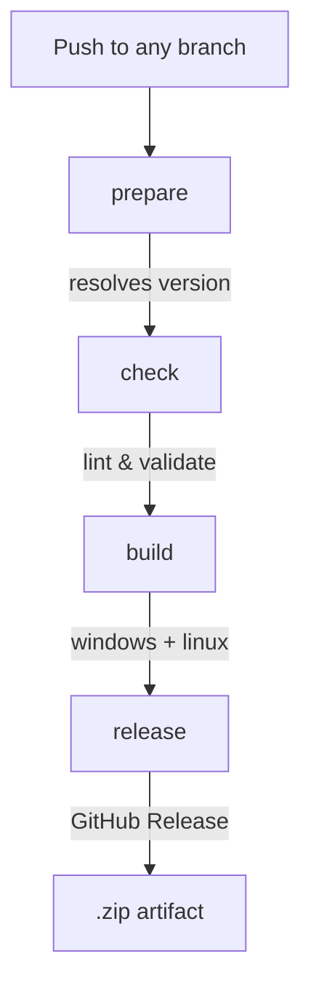

Once your mod works locally, set up **GitHub Actions** to build and release it automatically on every push.

## CI Architecture

Nox mods use a reusable workflow pipeline hosted at [`AtelierVR/mod.builder`](https://github.com/AtelierVR/mod.builder). Your workflow delegates to four jobs:



---

## Step 1 — Create the Workflow

Create `.github/workflows/build.yml` at the root of your mod repository:

```yaml title=".github/workflows/build.yml"
name: Build & Release

run-name: "${{ github.event.head_commit.message }} by @${{ github.actor }}"

on:
  push:
    branches: ["**"]
  pull_request:
    branches: ["main"]
  workflow_dispatch:
    inputs:
      version_override:
        description: "Override version (empty = auto)"
        required: false
        type: string
      no_library_cache:
        description: "Skip restoring the Library cache"
        required: false
        type: boolean
        default: false

permissions:
  contents: write

jobs:
  prepare:
    uses: AtelierVR/mod.builder/.github/workflows/prepare.yml@main
    with:
      override: ${{ inputs.version_override }}

  check:
    needs: prepare
    uses: AtelierVR/mod.builder/.github/workflows/check.yml@main

  build:
    needs: [ prepare, check ]
    uses: AtelierVR/mod.builder/.github/workflows/build.yml@main
    with:
      mod_id: ${{ needs.prepare.outputs.mod_id }}
      version: ${{ needs.prepare.outputs.version }}
      platforms: "windows linux"
      no_library_cache: ${{ inputs.no_library_cache || false }}
    secrets:
      UNITY_LICENSE: ${{ secrets.UNITY_LICENSE }}
      UNITY_EMAIL: ${{ secrets.UNITY_EMAIL }}
      UNITY_PASSWORD: ${{ secrets.UNITY_PASSWORD }}

  release:
    needs: [ prepare, build ]
    uses: AtelierVR/mod.builder/.github/workflows/release.yml@main
    with:
      mod_id: ${{ needs.prepare.outputs.mod_id }}
      version: ${{ needs.prepare.outputs.version }}
      tag: ${{ needs.prepare.outputs.tag }}
      prerelease: ${{ needs.prepare.outputs.prerelease }}
```

### Job Breakdown

| Job | What it does |
|---|---|
| **prepare** | Reads `nox.mod.json`, resolves the version. If `version` contains `x` (e.g., `1.0.x`), it calculates the next patch. If you push a tag like `v1.2.3`, it uses that exact version. |
| **check** | Lints the mod: validates `nox.mod.json`, checks assembly references, ensures required files exist. |
| **build** | Opens Unity in batch mode, compiles the mod, creates the AssetBundle, and zips the package. Builds for each platform in `platforms`. |
| **release** | Creates a GitHub Release with the `.zip` artifact attached. If the version has a `-preview` suffix, it's marked as a **prerelease**. |

---

## Step 2 — Configure Repository Secrets

Go to **Settings** → **Secrets and variables** → **Actions** in your GitHub repository and add:

| Secret | Description |
|---|---|
| `UNITY_LICENSE` | Unity Pro/Personal license file (`.ulf` content). |
| `UNITY_EMAIL` | Unity account email. |
| `UNITY_PASSWORD` | Unity account password. |

<Callout type="warn">
    Without these, the `build` job will fail — Unity cannot activate in CI.
</Callout>

---

## Step 3 — Version Resolution

The `prepare` job determines the version:

| Scenario | Resolved version |
|---|---|
| Push `v1.2.3` tag | `1.2.3` |
| Push to `main` with `"version": "1.0.x"` in `nox.mod.json` | `1.0.{latest_patch + 1}` |
| Manual `workflow_dispatch` with `version_override: "2.0.0-beta"` | `2.0.0-beta` |
| Push to a non-`main` branch | Build runs but no release is created |

<Callout type="info">
    Use `x` in your patch version (e.g., `1.5.x`) to let CI auto-bump.  
    For a manual release, push a tag: `git tag v1.5.3 && git push --tags`.
</Callout>

---

## Step 4 — First Push

```bash
git add -A
git commit -m "feat: initial mod setup with CI"
git push origin main
```

Head to the **Actions** tab of your repository. You should see the pipeline running.

---

## Adding More Platforms

Edit the `platforms` field in the `build` job:

```yaml
platforms: "windows linux android"
```

Supported values: `windows`, `linux`, `android`, `ios`, `macos`.

<Callout type="warn">
    Each additional platform increases build time. Android and iOS require extra Unity modules installed in CI.
</Callout>

---

## Skipping the Library Cache

If you encounter cache corruption issues, trigger a manual dispatch with `no_library_cache: true`:

1. Go to **Actions** → **Build & Release**.
2. Click **Run workflow**.
3. Check **Skip restoring the Library cache**.
4. Click **Run workflow**.

---

## Troubleshooting

| Problem | Solution |
|---|---|
| **Unity activation fails** | Check `UNITY_LICENSE`, `UNITY_EMAIL`, `UNITY_PASSWORD` secrets. Ensure the license allows CI usage. |
| **Build fails with missing assembly** | Add the missing dependency to `relations` in `nox.mod.json` and the `.asmdef` `references`. |
| **Release not created** | Only `main` branch pushes and tag pushes create releases. Feature branches only build. |
| **Version collision** | CI won't overwrite an existing release. Delete the old GitHub Release or push a new tag. |

---

## Full Example

See the [`my.super.mod`](https://github.com/example/my.super.mod) repository for a complete, working CI setup.
